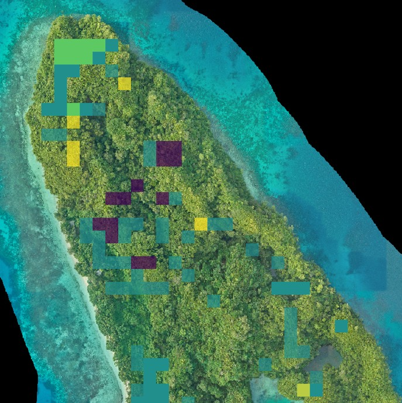

# Introduction

Islands are biodiversity hotspots that host nearly 20% of the world's species, despite making up only 6.7% of the Earth's land surface area ([Fernández-Palacios et al. 2021](https://doi.org/10.1016/j.gecco.2021.e01847)). Due to their geographic isolation from the continental mainland, many island ecosystems evolved to support endemic plant and animal species that are found nowhere else in the world. These species are uniquely adapted to island life, but this specialization also makes them highly vulnerable to environmental disturbance, climatic fluctuations, and introduced threats, leading to a high density of imperiled species on islands around the world ([Tershy et al. 2015](https://doi.org/10.1093/biosci/biv031)).

Protecting island ecosystems is crucial for conserving biodiversity, but many islands lack the long-term ecological data that is needed to support conservation and restoration initiatives. Without these data, land managers and conservation practitioners cannot easily monitor ecosystem change caused by the establishment of non-native species, natural resource use, or climate change. They also cannot assess outcomes of targeted conservation actions, such as the removal of an invasive species, planting of native vegetation, or reintroduction of extirpated native species.

Satellites provide us with large-scale, long-term observations of the Earth's surface. When *in situ* data collected from field surveys are sparse, outdated, or unavailable, satellite observations can fill the data gap, helping us better track ecosystem health and function. *Island Vital Signs* is a tool that turns remotely sensed data into actionable insights that can contribute to conservation and restoration efforts on islands around the world by utilizing satellite-derived Earth observation data to monitor change in island vegetation communities and quantify long-term vegetation trends. We provide these data through an online decision-support tool, where end-users can visualize vegetation change on over 50 islands worldwide and download rasters that can be used in mapping applications, including ESRI products (ArcGIS Pro, ArcGIS Collection, etc.), QGIS, and Avenza Maps.

The purpose of this book is to provide an overview of the *Island Vital Signs* project and its methods, explain how to access data and use the *Island Vital Signs* tool to visualize vegetation change, and describe several use case studies that demonstrate real-world applications of the Island Vital Signs data in conservation and restoration decision-making.

```{r echo=FALSE, label="satellite-imagery-graphic", out.width='60%', fig.align='center', fig.cap='Satellite observations provide insight into what is happening on Earth\'s surface, even in some of the most remote and difficult-to-access locations on the planet.'}

```
