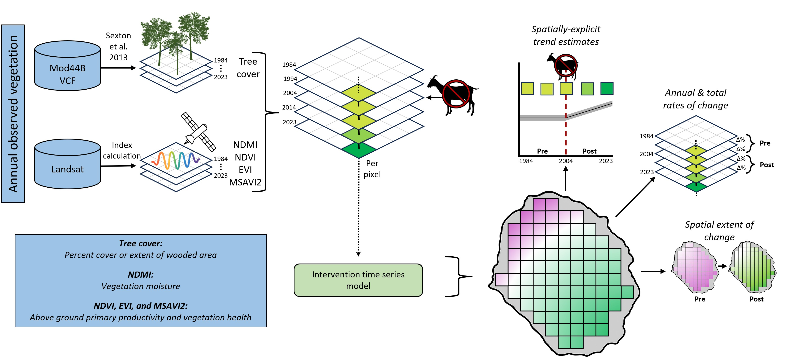
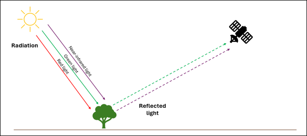
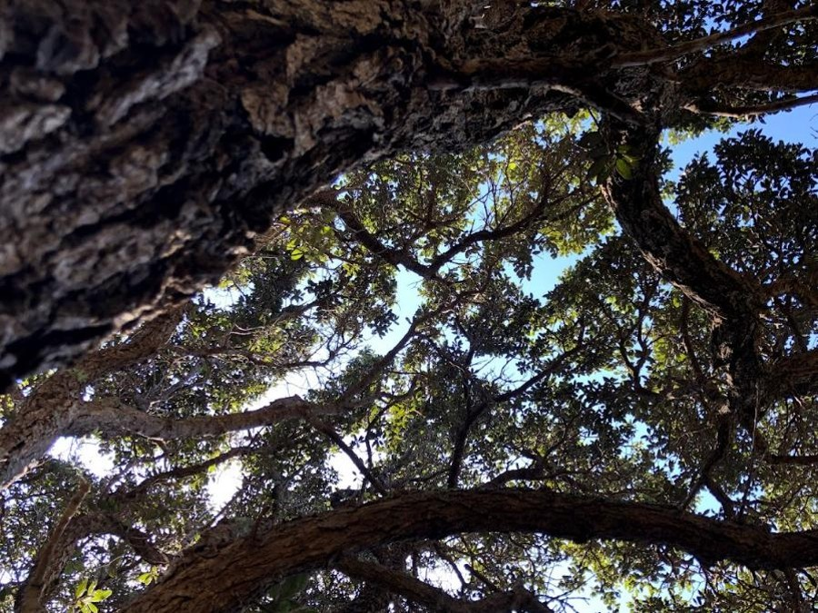
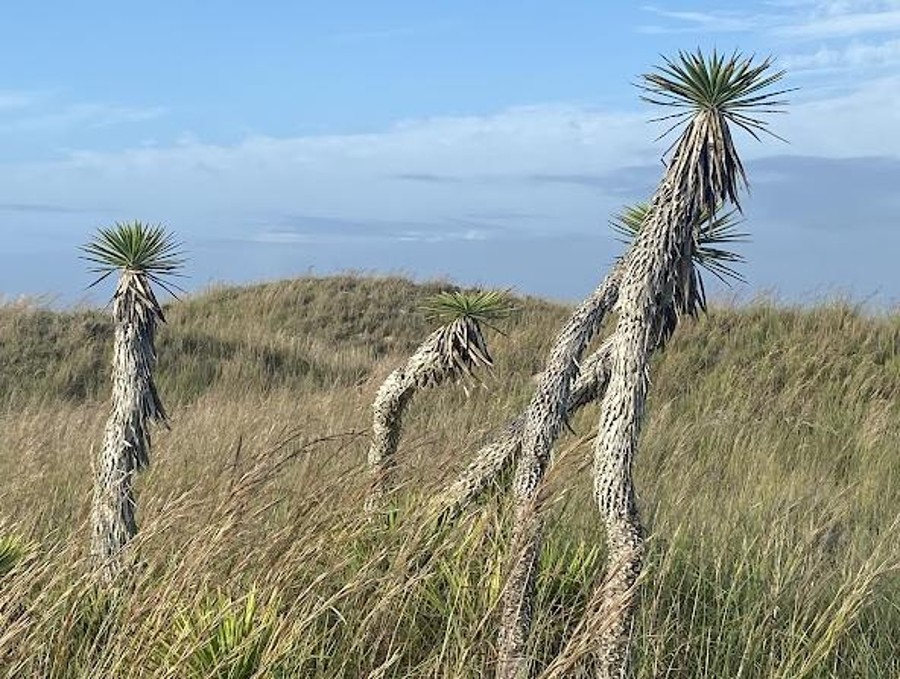
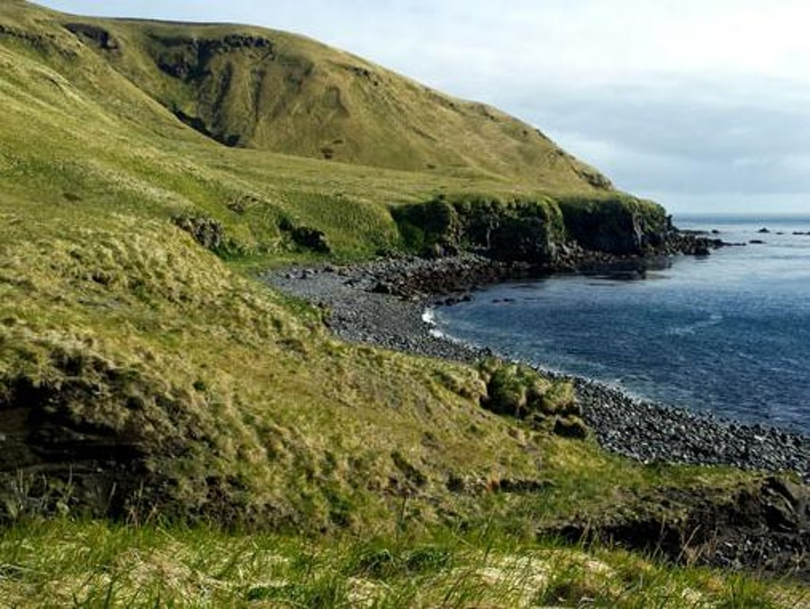
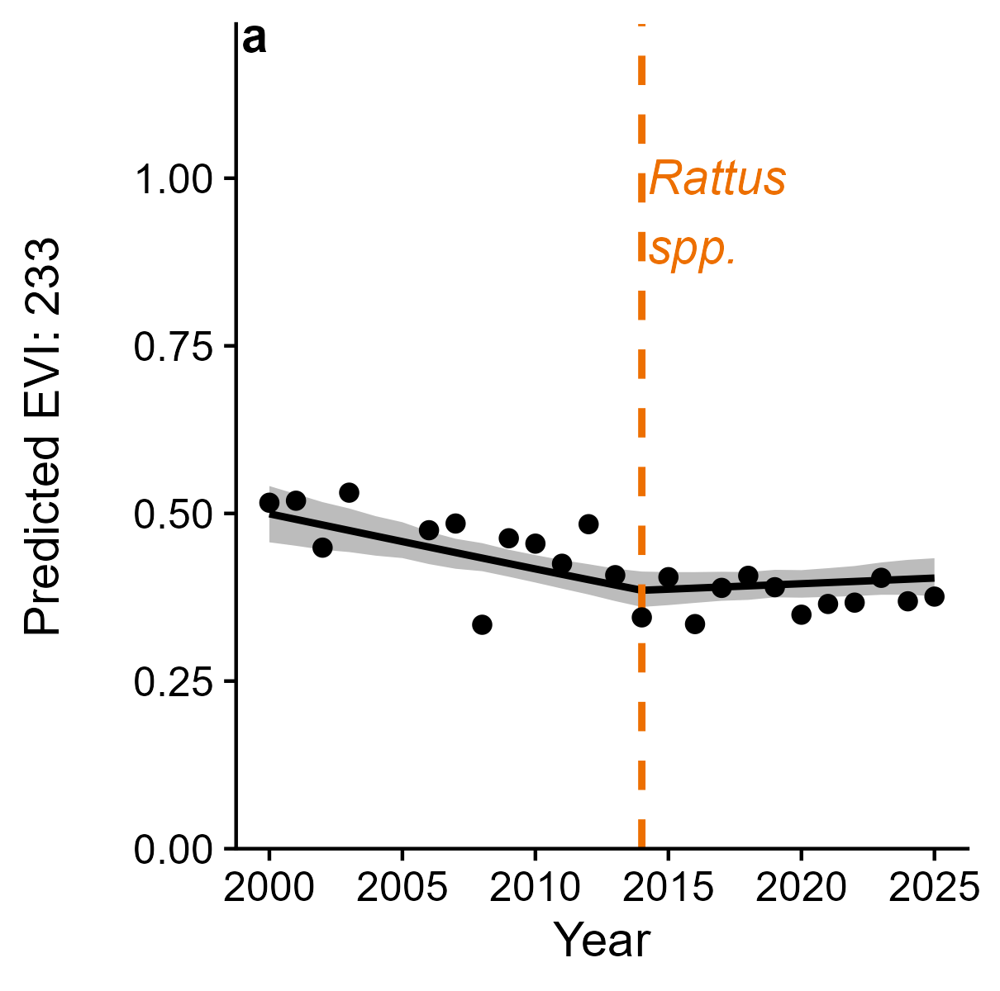
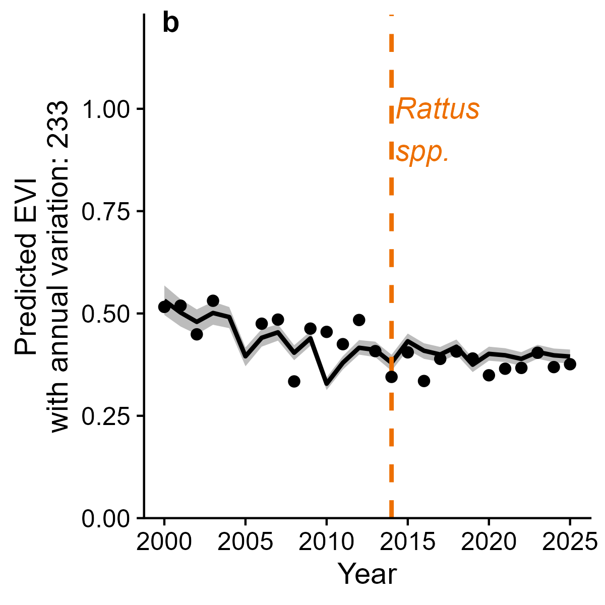
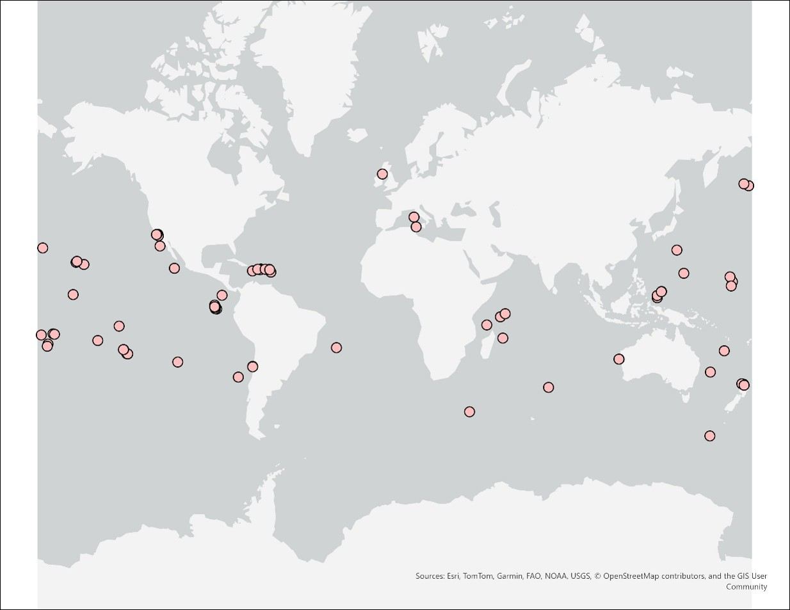

# Methods

```{r setup, include = FALSE}
library(tidyverse)
library(kableExtra)
```

## Analytical Workflow

```{r echo=FALSE, label="workflow-graphic", out.width='100%', fig.align='center', fig.cap='Steps within the analytical framework for *Island Vital Signs*. Satellite-derived observations of vegetation are analyzed using intervention time series analysis to estimate vegetation trends. The model outputs are useful for quantifying annual and total rates of change, detecting directional change and patterns within a time series, and the spatial extent of change on vegetation communities on remote islands.'}

```

*Island Vital Signs* uses time series analysis to measure how vegetation has changed across an island and over time. We track change in vegetation structure and function using mean annual observations of vegetation metrics that are derived from satellite data. These data are collected within a 30 m grid, with each pixel representing a 30 m x 30 m (0.09 ha) area on the ground. We use simple and interrupted time series models to analyze how the data for each pixel changes over time, allowing us to examine patterns and trends in the vegetation data *over time*, and track *where* change is occurring. Across the next few sections, we describe in more detail the different parts of this analytical framework and how we turn satellite data into actionable insights for island ecosystem conservation and restoration.

## Landsat and Earth Observation (EO) Data

The National Aeronautics and Space Administration (NASA) and U.S. Geological Survey (USGS) Landsat mission is an Earth observations program that uses satellite remote sensing to capture information about the Earth's surface. The program provides free and open-source, medium spatial resolution (30–80 m) multi-spectral data that spans up to 40 years for many of the landmasses on Earth. Landsat satellites are equipped with passive remote sensing instruments that measure light reflected from the Earth's surface. These sensors measure *multispectral data*, meaning they detect multiple wavelengths across the electromagnetic spectrum including visible (blue, green, and red) and infrared (near and mid) light. Differences in the way that this light is reflected (i.e., spectral signatures) provide us with information about objects and materials covering the Earth's surface. For example, plant leaves absorb red light and reflect green and near-infrared light, while water absorbs green, red, and near-infrared light while reflecting blue light.

```{r echo=FALSE, label="passive-remote-sensing", out.width='100%', fig.align='center', fig.cap='Passive remote sensing instruments observe the Earth by measuring the amount and type of light reflected from the Earth\'s surface. We can identify an area with dense vegetative cover based on how it absorbs red visible light and reflects green and near-infrared light.'}

```

Landsat-derived surface reflectance data are useful for a wide range of scientific disciplines, including agriculture, forestry, hydrology, ecology, meteorology, atmospheric science, and biodiversity conservation. Within the realm of ecology, surface reflectance-derived spectral indices, such as the Normalized Difference Vegetation Index, have been used to map changes in landcover and the structure, composition, and function of vegetation communities, making them useful for monitoring ecosystem change from afar. In *Island Vital Signs*, we use these data to track vegetation change on remote islands around the world.

For more information about satellite remote sensing, we recommend referring to NASA Applied Remote Sensing Training Program's free online course ['Fundamentals of Remote Sensing'](https://www.earthdata.nasa.gov/learn/trainings/fundamentals-remote-sensing) or The Global Rewilding Alliance's guide ['Leveraging Space for Rewilding: How Satellite Remote Sensing is Unlocking New Possibilities for Rewilding Success.'](https://drive.google.com/file/d/1BacK5aWrbbFu0xzcUqPo6D0sF0BaNOGF/view)

## Remotely sensed vegetation metrics

*Island Vital Signs* predicts pixel-based time series trends for three remotely sensed vegetation metrics: canopy cover, vegetation moisture (Normalized Difference Moisture Index; NDMI), and vegetation productivity (Normalized Difference Vegetation Index, NDVI; Enhanced Vegetation Index, EVI; or Modified Soil Adjusted Vegetation Index 2, MSAVI2). These vegetation metrics can be examined together to provide a more complete picture of change in the structure and function of island vegetation communities over time.

All remotely sensed data products used in *Island Vital Signs* models are produced by terraPulse, Inc (Gaithersburg, Maryland, USA). Canopy cover is derived from Landsat imagery using a regionally- or locally-calibrated tree cover model trained with [MODIS Vegetation Continuous Fields (VCF)](https://modis.gsfc.nasa.gov/data/dataprod/mod44.php) data. NDMI, NDVI, EVI, and MSAVI2 are derived from the [NASA Landsat Collection 2 Level-2 dataset](https://www.usgs.gov/landsat-missions/landsat-collection-2), which contains atmospherically corrected multispectral reflectance data. More information on the [canopy cover data product](https://www.terrapulse.com/products/forest/) and [spectral indices data products](https://www.terrapulse.com/products/indices/) (i.e., NDMI, NDVI, EVI, and MSAVI2) are available from terraPulse, Inc.

**Tree Canopy Cover:** Tree canopy cover is defined as the proportion of an area covered by forest or shrubland. In many regions, especially forests and shrublands, this variable may represent trees or woody cover that form a canopy layer that is taller than the surrounding vegetation. The tree canopy cover variable used in *Island Vital Signs* is produced using a model trained with MODIS VCF (surface vegetation cover) data and fit to Landsat imagery ([Sexton et al. 2013](https://www.tandfonline.com/doi/full/10.1080/17538947.2013.786146)). For areas where MODIS reference data is not available to train the model, a model trained on data from a comparable global ecological zone ([FAO 2017](https://data.apps.fao.org/catalog/iso/2253d48c-b371-4025-b4ee-a6582bc06b51)) with similar vegetation and environmental conditions is used to quantify tree canopy cover. Tree canopy cover is a practical metric for assessing vegetation density and structure. It can be used to track forest loss and recovery. The values range from 0 to 100% cover, with higher values (i.e., 75–100%) representing dense or closed canopy while lower values (i.e., 0–25%) represent deforested areas or sparse canopy.

```{r echo=FALSE, label="pokohinu-canopy", out.width='55%', fig.align='center', fig.cap='Tree canopy on Pokohinu Island in the Mokohīnau Islands, Aotearoa New Zealand. Photo by Christy N. Wails.'}

```

**Normalized Difference Moisture Index:** The Normalized Difference Moisture Index (NDMI) quantifies vegetation water content by measuring the ratio between near-infrared (NIR) and short wavelength infrared (SWIR) light reflectance from the Earth's surface ([Gao 1996](https://www.sciencedirect.com/science/article/abs/pii/S0034425796000673?via%3Dihub)).

$$NDMI = \frac{(NIR - SWIR)}{(NIR + SWIR)}$$

NDMI values range from -1 to 1, though negative values typically indicate barren, non-vegetated areas. High values near 1 indicate areas with high vegetation moisture content, while low values near 0 indicate areas with low vegetation moisture content. NDMI is useful for monitoring water stress during drought conditions ([Sankey et al. 2020](https://zslpublications.onlinelibrary.wiley.com/doi/pdf/10.1002/rse2.186)), detecting changes in the structure of the vegetation community ([Wilson and Sader 2002](https://www.sciencedirect.com/science/article/abs/pii/S0034425701003182)), and identifying vegetation communities adapted to different environments (i.e., hydrophytic plants adapted to moist environments such as wetlands, versus xerophytic plants adapted to arid environments such as deserts and shrublands).

```{r echo=FALSE, label="padre-xerophytic", out.width='55%', fig.align='center', fig.cap='Xerophytic (dry adapted) vegetation on Padre Island, Texas, USA. Photo by Christy N. Wails.'}

```

**Normalized Difference Vegetation Index:** The Normalized Difference Vegetation Index (NDVI) quantifies plant greenness by measuring the ratio between NIR and red light reflectance from the Earth's surface ([Rouse et al. 1974](https://ntrs.nasa.gov/api/citations/19740022614/downloads/19740022614.pdf)).

$$NDVI = \frac{(NIR - Red)}{(NIR + Red)}$$

NDVI values can range from -1 to 1, but values are nearly always positive (NDVI ≥ 0) for areas on land. Healthy, photosynthetically active vegetation that contains high amounts of chlorophyll will strongly reflect NIR and absorb red light, resulting in NDVI values near 1. In contrast, sparsely vegetated or barren areas that contain little chlorophyll will reflect more red light relative to NIR, resulting in NDVI values near 0. NDVI can be used to track vegetation health, growth, and density.

**Enhanced Vegetation Index:** In areas with high biomass, NDVI becomes oversaturated and loses sensitivity, limiting its ability to appropriately distinguish areas with different levels of plant greenness and vegetation density ([Huete et al. 2002](https://www.sciencedirect.com/science/article/pii/S0034425702000962)). At high NDVI values, large changes in vegetation growth and density may only be measured as small changes in the NDVI index. The Enhanced Vegetation Index (EVI) is similar to NDVI but is corrected for canopy background noise and atmospheric conditions, allowing for greater sensitivity in areas with dense vegetation and humid environments, such as tropical rain forests, tropical moist deciduous forests, and subtropical humid forests ([Huete et al. 2002](https://www.sciencedirect.com/science/article/pii/S0034425702000962), [Shi et al. 2017](https://www.sciencedirect.com/science/article/pii/S1470160X16304836#bib0125)).

**Second Modified Soil Adjusted Vegetation Index:** In areas with sparse vegetation, light reflectance from the soil surface and exposed rock may also skew NDVI values. The second Modified Soil Adjusted Vegetation Index (MSAVI2) is similar to NDVI but reduces the effect of bare soil on the vegetation density calculation ([Qi et al. 1994](https://www.sciencedirect.com/science/article/abs/pii/0034425794901341)). It is useful for monitoring vegetation density and growth in arid and semi-arid ecosystems, such as dry forests, shrublands, deserts, and steppe.

```{r echo=FALSE, label="anangusix-grasses", out.width='55%', fig.align='center', fig.cap='Native grasses on Gareloi/Anangusix̂ Island in the Aleutian Islands, Alaska, USA. Photo by Christy N. Wails.'}

```

**A note on productivity indices:** NDVI, EVI, and MSAVI2 are all useful spectral indices for measuring vegetation greenness, productivity, and health. We select a vegetation productivity index to analyze for each island based on the island's global ecological zone ([FAO 2017](https://data.apps.fao.org/catalog/iso/2253d48c-b371-4025-b4ee-a6582bc06b51)). We use NDVI for wet non-tropical islands, EVI for wet tropical islands, and MSAVI2 for arid or semi-arid islands.

## Processing remote sensing data products

We generate time series for tree canopy cover, vegetation moisture, and productivity from Landsat Collection 2 Level-2 surface reflectance data, which are available at a 30 m spatial resolution. This means that each pixel within the raster datasets represents a 30 m x 30 m area on the ground. Prior to processing the data, we exclude Landsat scenes that have ≥ 70% cloud cover. From the remaining scenes, we remove cloud and shadow contamination by applying a mask derived from the auxiliary pixel quality assessment band. We then scale pixel values to percent reflectance using Landsat metadata.

For each island within the dataset, we crop the Landsat scenes to the spatial extent of the island. We then remove all cells that are within 30 m of the island boundary to produce a final set of rasters that are slightly smaller than the full extent of the island boundary. We do this to reduce any potential error caused by year-to-year shifts in the position of the coastline as a result of erosion or accretion.

When possible, we analyze raster time-series using the native 30 m resolution. However, for islands with > 4,000 pixels in their rasters (typically islands > 5 km^2^), we aggregate the data using a scaling function that selects an aggregation factor based on raster size ([Wails et al. 2026](https://doi.org/10.21203/rs.3.rs-10554051/v1)). This allows us to select the finest spatial resolution possible for each island (which is important when applying the data to conservation management decision-making), while also balancing the computational demands of analyzing large raster datasets. Most islands in the dataset do not exceed an aggregation factor of 10 (i.e., spatial resolution of approximately 300 m).

## Time series analysis

We analyze vegetation change on each island within the dataset using a set of rasters, where each raster represents a year within the time-series and each pixel contains a value for tree canopy cover, vegetation moisture, and productivity. We use raster time-series spanning 1984 to approximately present (as of 2026, most time series ended in 2024 or 2025). However, data may not be available for all years in that period for all islands (for example, due to cloud or shadow contamination), so the length of each individual island time-series varies.

Time series analysis uses long-term datasets to examine how values change over time, providing the opportunity to detect trends, visualize patterns, and identify anomalies in the data. In *Island Vital Signs*, we use time series analysis to assess annual change in the remotely sensed indices for tree canopy cover, vegetation moisture, and productivity over time, as well as estimate long-term temporal trends for each vegetation metric. We analyze the time series data by fitting Bayesian hierarchical models for each vegetation metric using the R package [*brms*](https://cran.r-project.org/web/packages/brms/index.html) with [Stan](https://mc-stan.org/about/). Each of the models included: (1) a random intercept for time, which allows for variation in initial vegetation conditions, and (2) a pixel-specific random slope for time (and time since intervention, if applicable) to allow vegetation trends to vary spatially across an island.

For islands without documented eradication operations or other conservation interventions, we use a simple time series analysis to predict trends:

$$Y_{t} = \alpha + \beta_{1}time + \beta_{0}lag + \varepsilon_{t}$$

where $\alpha$ is an island-level intercept, $\beta_{1}$ represents the overall trend, $\beta_{0}$ is a lagged vegetation response (i.e., the vegetation metric from the previous year), and $\varepsilon_{t}$ is an error term.

For islands where an eradication operation or other conservation intervention action occurred, and there are at least five years of vegetation data after the intervention, we examine the data using an interrupted time-series analysis to estimate change in each vegetation metric across the full time-series, in the time period before the intervention, and in the time period after the intervention to help determine the intervention's effect on the vegetation community:

$$Y_{t} = \alpha + \beta_{1}time + \beta_{2}time.post + \beta_{0}lag + \varepsilon_{t}$$

where $\alpha$ is an island-level intercept, $\beta_{1}$ represents the overall trend, $\beta_{2}$ represents the post-intervention trends, $\beta_{0}$ is a lagged vegetation response (i.e., the vegetation metric from the previous year), and $\varepsilon_{t}$ is an error term.

In v1.0.0 of the models, we fit models for tree canopy cover and productivity with a Beta error distribution with a logit link function and address temporal dependence among repeated observations within each pixel using a lagged response that uses the value of each vegetation metric from the previous year. We fit models for vegetation moisture with a truncated Gaussian distribution and address temporal autocorrelation using a first-order autoregressive process.

In v2.0.0 of the models, we scale NDMI to the same range as tree canopy cover, NDVI, EVI, and MSAVI2 (i.e., 0–1) and then analyze vegetation moisture using the same modeling approach as tree canopy cover and productivity. For visualization and interpretation, we rescale NDMI back to its appropriate value. We do not find that this method significantly alters results. This model version produces modeling outputs that are marginally more comparable across vegetation metrics. Additionally, it improves the vegetation moisture model so that it requires fewer computational resources.

For more details about model structure and model implementation procedures, including the priors selected for each model parameter, please see [Wails et al. 2026](https://www.researchsquare.com/article/rs-10554051/v1).

## Model predicted vegetation values

The models for *Island Vital Signs* estimate vegetation metric values for all pixels in each year of the time series. The models predict values for each pixel-year combination while holding the lagged vegetation covariate constant at the mean value for each pixel. This practice allows for conservation predicted trends by removing temporal autocorrelation. By examining values for each pixel-year combination, we can observe long-term change within each pixel. There are two ways that the models predict long-term change for each pixel:

(1) A smooth trend that reflects expected long-term vegetation trend. This is generated by including pixel-level random intercepts and temporal slopes but excluding the year-level random intercept.

```{r echo=FALSE, label="tenarunga-evi-smooth", out.width='50%', fig.align='center', fig.cap='Example predicted smoothed EVI trend for a pixel on Tenarunga Atoll, Tuamotu-Gambier, French Polynesia. The black points represent raw EVI observations. The line represents the smoothed model-predicted trend for 2000–2025. The grey shaded area represents the 85% highest posterior density interval, i.e., the area in which the true trend is at least 85% likely to occur.'}

```

(2) A trend that allows for interannual variability. This is generated by including the year-level random intercept.

```{r echo=FALSE, label="tenarunga-evi-variability", out.width='50%', fig.align='center', fig.cap='Example predicted EVI trend with interannual variability for a pixel on Tenarunga Atoll, Tuamotu-Gambier, French Polynesia. The black points represent raw EVI observations. The line represents the model-predicted trend for 2000–2025. The grey shaded area represents the 85% highest posterior density interval, i.e., the area in which the true trend is at least 85% likely to occur.'}

```

## Model predicted vegetation trends

We also derive estimates of accumulated change (i.e., total change, calculated as the difference between predicted vegetation values at the end and beginning of a time period) and annualized change (i.e., annual rate of change, calculated by dividing accumulated change by the number of years in a time period) for each vegetation metric. On islands where an eradication did not occur and we use a simple time-series analysis, we derive accumulated and annualized change across the full time-series. On islands where we fit an intervention to represent a completed eradication operation, we derive accumulated and annualized change for (1) the pre-intervention period (i.e., before the eradication), (2) the post-intervention period (i.e., after the eradication), and (3) the full time-series (i.e., including both the pre- and post-intervention period). We also estimate the difference in change between the post- and pre-intervention periods (i.e., dynamic baseline), allowing for evaluation of the effects of the intervention on the vegetation metric.

## Islands with available data

The *Island Vital Signs* dataset includes predicted vegetation trends for nearly 75 islands around the world. These islands cover a range of environmental and climatic conditions. Twelve biomes are represented in the dataset, ranging from tropical and subtropical moist broadleaf forest to tundra. On many islands, invasive species are present for part or all of the modeled time series. When possible, we have included a model effect for removal of an invasive species in the time series, allowing for comparison of vegetation trends from before and after a completed invasive species eradication project.

```{r echo=FALSE, label="island-locations", out.width='85%', fig.align='center', fig.cap='Location of islands with available vegetation trend data in *Island Vital Signs* as of Fall 2026.'}

```

```{r island-lookup-table, echo = FALSE}
island.lookup <- read.csv("tables/island_lookup_table.csv", check.names = FALSE)

kbl(
  island.lookup,
  align = "l",
  caption = "Details for all islands that are currently available in *Island Vital Signs* as of Fall 2026. Global ecological zones are based on the Global Ecological Zones dataset from the Global Forest Resources Assessment of the Food and Agriculture Organization of the United Nations ([FAO 2010](https://data.apps.fao.org/catalog/dataset/2fb209d0-fd34-4e5e-a3d8-a13c241eb61b)). Biomes, realms, and ecoregions are based on the RESOLVE Ecoregions dataset ([Dinerstein et al. 2017](https://academic.oup.com/bioscience/article/67/6/534/3102935?login=false))."
) %>%
  kable_styling(bootstrap_options = c("striped", "condensed"), font_size = 9) %>%
  scroll_box(width = "100%", height = "600px")
```
