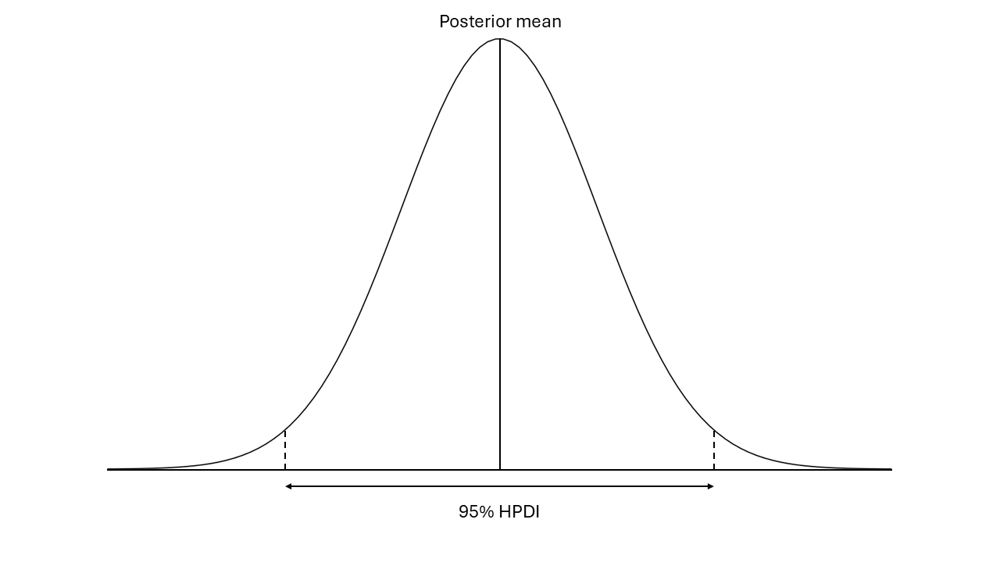
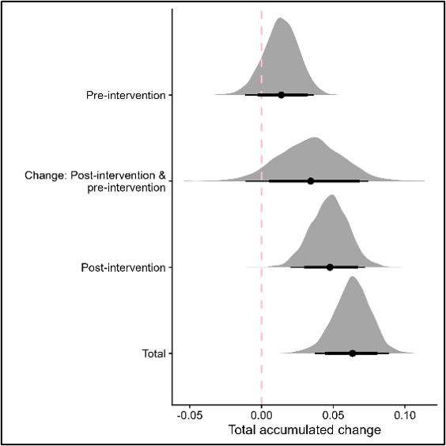
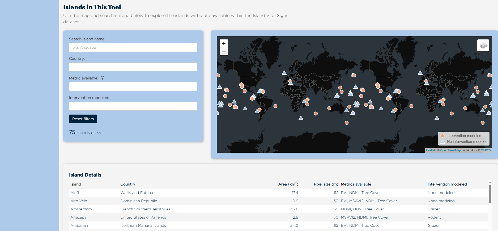
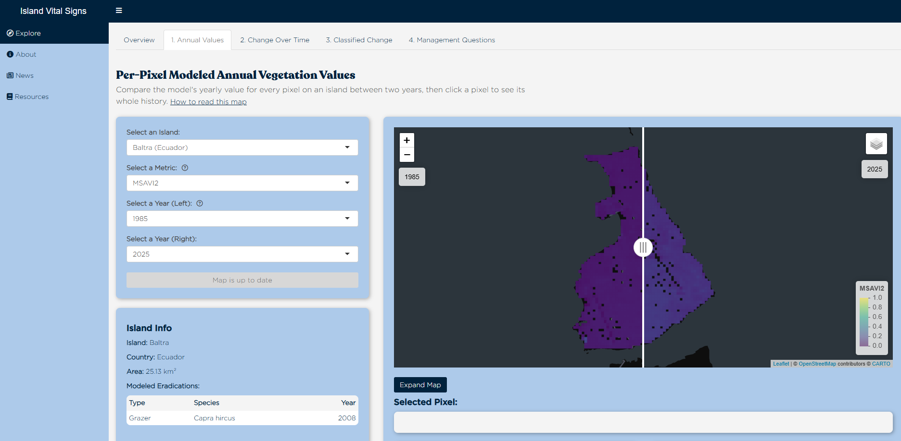
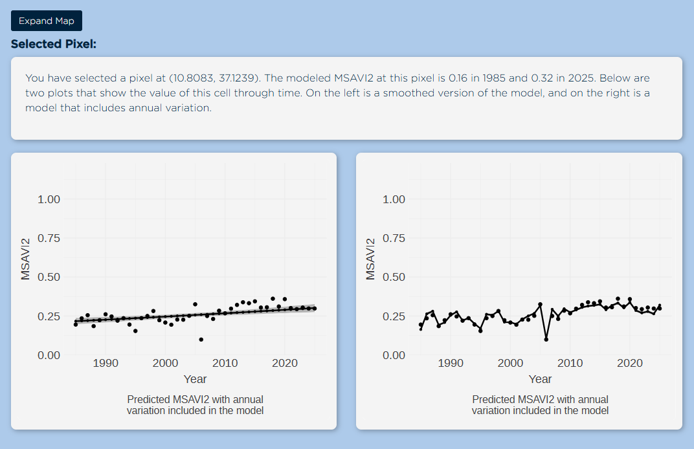
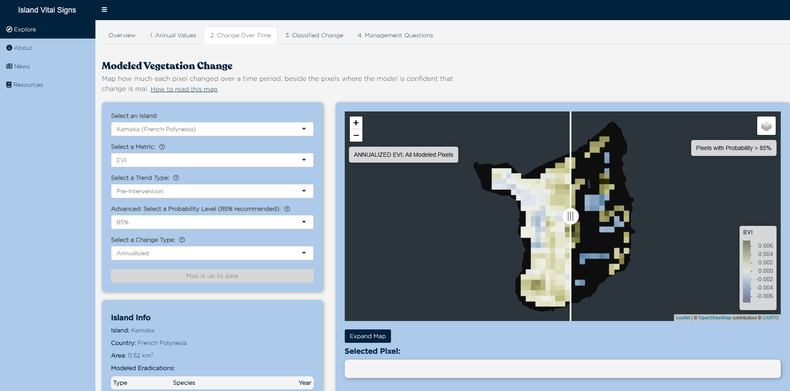
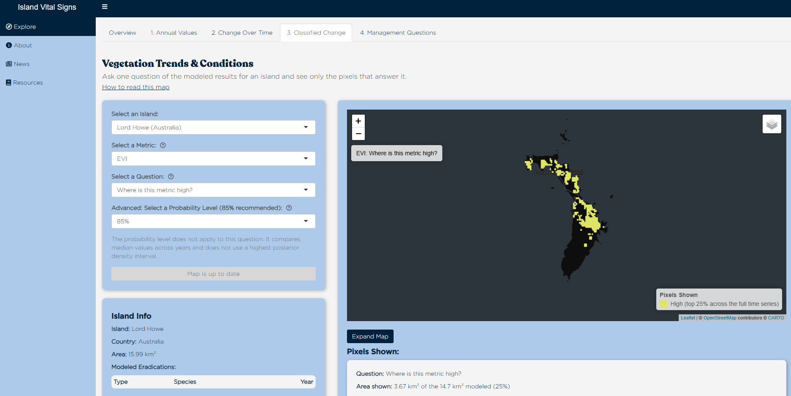
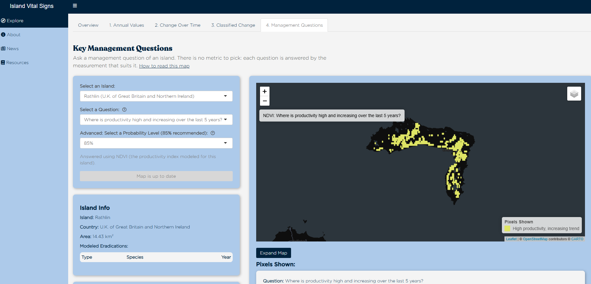

# Application Walkthrough

```{r app-setup, include = FALSE}
library(tidyverse)
library(kableExtra)
```

*Island Vital Signs* is an [RShiny](https://shiny.posit.co/r/getstarted/shiny-basics/lesson1/) application developed using R version 4.4.1. It is available online at <https://islandconservation-island-vital-signs.share.connect.posit.cloud/>. The application provides an interface for users to interact with long-term vegetation trend data for over 50 islands worldwide. Users can use the app to visualize spatially explicit time-series data, explore historical trends, and download data that can be integrated into existing analytical and decision-making workflows. This section explains each part of the application and how to use it to access island vegetation data.

## A primer on Bayesian model outputs

*Island Vital Signs* can be used to visualize spatially explicit time-series data and trends estimated from Landsat observations using Bayesian hierarchical models. A key output from each of these models is the **posterior distribution**, which describes the *full range of possible values* for each model parameter. A model parameter is something that we are interested in estimating using the model, such as a per-pixel annual vegetation metric value or trend. All values within the posterior distribution are plausible estimates for a model parameter, while values outside of the posterior distribution are not plausible estimates for a model parameter.

Posterior distributions are *probability distributions*, meaning we can determine how likely a model-predicted value is to be the *true* value (i.e., the real per-pixel annual vegetation metric value or vegetation metric trend) based on where it falls within the posterior distribution. The greatest mass of the posterior distribution is below the **posterior mean** (i.e., the average value in the posterior distribution), so we conclude that the mean has the greatest probability of being the *true* value. When we report models results in *Island Vital Signs*, we report the posterior mean as the **model estimated value** for a parameter.

We can describe uncertainty in model estimates using **highest posterior density intervals (HPDI)**. HPDIs are the narrowest intervals containing a specified proportion of the posterior distribution. For example, the 95% HPDI includes 95% of the posterior distribution, while the 85% HPDI includes 85% of the posterior distribution. We can use HPDIs to determine how likely it is that the true value of a parameter falls within a given interval. There is a 95% probability that a parameter's true value lies within the 95% HPDI. Similarly, there is an 85% probability that a parameter's true value lies within the 85% HPDI.

```{r echo=FALSE, label="posterior-distribution", out.width='70%', fig.align='center', fig.cap='The posterior distribution contains all possible values for a model parameter. The posterior mean is the average value within the distribution. The 95% highest posterior density interval is the range of values in the posterior distribution that contains 95% of the probability mass.'}

```

In *Island Vital Signs*, we also use HPDIs to describe the model's certainty about directional trends. If an HPDI *excludes* zero, we assume that the model is certain about the direction of the trend for that vegetation metric at the specified probability level. If an HPDI *includes* zero, we assume that the model is uncertain about the direction of the trend for that vegetation metric.

We can explain the concept of posterior distributions using the figure below, which shows example posterior distributions for model-predicted accumulated change in MSAVI2 on Lehua Island (Hawaiʻi, United States of America). In this figure, the grey shaded areas provided a visualization of the posterior distribution for four model parameters. From top to bottom on the y-axis of the figure, these parameters are:

1. Accumulated change in MSAVI2 prior to the eradication of European rabbits (*Oryctolagus cuniculus*) in 2006.
2. The dynamic baseline, i.e., the difference in accumulated change in MSAVI2 between the time-period before and after rabbits were eradicated.
3. Accumulated change in MSAVI2 after rabbits were eradicated.
4. Total accumulated change in MSAVI2 across the full time-series.

For each posterior distribution, the black dot indicates the posterior mean, or the model-estimated value for the parameter. All posterior means fall to the right of 0 (i.e., are positive), indicating that the model predicts an increasing trend in MSAVI2 for all parameters.

The thin black lines under each posterior distribution represent the 95% HPDI, while the thick black lines represent the 85% HPDI. The HPDIs for the posterior distributions for accumulated change in MSAVI2 illustrate three different scenarios with regard to model certainty about directional change.

1. The 85% *and* 95% HPDIs for the total and post-intervention periods are fully to the right of 0 (i.e., exclude zero), indicating a > 95% probability of an increasing trend in MSAVI2 across the full time-series and after the eradication of rabbits.
2. In contrast, the 95% *and* 85% HPDIs for the pre-intervention period overlap with zero, suggesting model uncertainty about whether MSAVI2 was increasing or decreasing prior to the eradication of rabbits.
3. Finally, the 95% HPDI for the dynamic baseline overlaps with zero, while the 85% HPDI excludes zero. This indicates that probability that the difference between accumulated change before and after the eradication is positive (i.e., accumulated change is greater post-intervention, relative to pre-intervention) is between 85 and 95%.

```{r echo=FALSE, label="lehua-msavi2-distribution", out.width='55%', fig.align='center', fig.cap='Example posterior distributions for model-predicted accumulated change in MSAVI2 on Lehua Island, Hawai\'i, United States of America for 2000–2024 (with a modeled intervention in 2006).'}

```

## Overview: Islands in this Tool

```{r echo=FALSE, label="islands-in-this-tool-screenshot", out.width='100%', fig.align='center', fig.cap='Screenshot of the landing page for *Island Vital Signs* from November 2026.'}

```

The 'Islands in this Tool' section on the overview page for *Island Vital Signs* allows users to explore details about the islands with data available within the *Island Vital Signs* data set. The map on the left side of the screen shows the locations of islands with available data. Islands represented by a red dot were modeled with an interrupted time series that included a conservation intervention (i.e., eradication of an invasive species), so that we can explore changes in vegetation trends from before and after the intervention. Islands represented by a blue dot were modeled with a simple time series that did not include a conservation intervention. Below the map, the 'Island Details' table provides important information for each island in the data set, including country, island size (area in km^2^), resolution (i.e., pixel size used in analysis), analyzed vegetation metrics, and modeled interventions.

Users can search the dataset for an island by name or filter the data to only view islands that match selected criteria, such as country, modeled vegetation metrics (tree canopy cover, NDMI, NDVI, MSAVI2, EVI), or modeled interventions (carnivore, grazer, plantation, primate, rodent, or none). Once a filter is applied, the map and table will automatically update to only include information for the filtered islands. For example, selecting 'Rodent' under 'Intervention modeled' will filter the data set to only show islands where rodents (e.g., *Mus muscalus*, *Rattus rattus*, *Rattus exulans*, *Rattus norvegicus*) have been eradicated, and that eradication was included as an intervention in the model.

Users can then use the map and table to explore islands that match the filtering criteria. If you would like to know more about an island, you can select it on the map to view its name, country, size, resolution, metrics, and modeled interventions. You can also choose to open the island in one of the modules to view the modeled vegetation outputs for the island.

## Module 1: Annual Values

```{r echo=FALSE, label="annual-values-screenshot", out.width='100%', fig.align='center', fig.cap='Screenshot of the Annual Values module on *Island Vital Signs*, showing data for Isla Baltra, Ecuador. Screenshot from November 2026.'}

```

The 'Annual Values', or 'Per-Pixel Modeled Annual Vegetation Values', module displays model-predicted yearly averages for tree canopy cover, vegetation moisture, and productivity for each pixel in an island raster. Average values are available for each year in the time series. The module is designed to allow users to view estimated vegetation metric values for two years at once, providing the opportunity to observe location-specific differences in vegetation metrics between two years.

To use the module, start by selecting an island name from the drop-down menu. Once an island is selected, the application will automatically populate a box labeled 'Island Info' that provides details on the island name, country, and island area. The Island Info box will also indicate if the vegetation models for the island include an eradication intervention. To see vegetation data for the island, select a vegetation metric and two years from the available time series for the island. Once the selections are made, click 'Load Map' to see the data displayed on a Leaflet map on the right side of the screen.

Each map features a slider bar which may be moved back and forth across the map. All pixels to the left of the slider bar display values from the first selected year. All pixels to the right of the slider bar display values from the second selected year. Moving the slider bar completely to the left side of the map displays only values from the first selected year. Moving the slider bar completely to the right side of the map displays only values from the second selected year.

You can further interact with the data by selecting a pixel on the map. The application will display the pixel's latitude, longitude, and predicted values for each year for each cell that you select. Below the map, the application will also display two graphs showing the modeled time series for the vegetation metric within that cell. The graph on the left shows the smoothed trend for the time-series, which reduces the effects of short-term variation and random fluctuations in the data to show the overall pattern or direction of change. The graph on the right shows the trend with interannual variation, meaning it depicts year-to-year changes in the vegetation metric.

```{r echo=FALSE, label="cell-time-series-screenshot", out.width='100%', fig.align='center', fig.cap='Screenshot from the Annual Values module showing the modeled time series for MSAVI2 in a pixel on Zembra, Tunisia. The plot on the left shows a smoothed, increasing trend. The plot on the right shows an overall increasing trend with annual variation.'}

```

These graphs display the mean estimated value for the vegetation metric within that cell for each year in the time series (black dots). The black line shows the predicted trend for the vegetation metric across the full time series. The grey shaded area around the trend line shows the 85% highest posterior density interval (HPDI), which represents the range of values with an 85% probability of containing the true value for the vegetation metric. If the grey shaded area does not appear to be visible around the trend line, there is a narrow interval for the 85% HPDI, meaning the model is more certain that the depicted trend is the true trend. If the grey shaded area is wide around the trend line, then the model is less certain that the depicted trend is the true trend.

## Module 2: Change Over Time

```{r echo=FALSE, label="change-over-time-screenshot", out.width='100%', fig.align='center', fig.cap='Screenshot of the Change Over Time module on *Island Vital Signs*, showing data for Kamaka Island, French Polynesia. Screenshot from November 2026.'}

```

The 'Change Over Time', or 'Modeled Vegetation Change', module displays spatially explicit, model-predicted trends for each vegetation metric over time. The module can help visualize how much tree canopy cover, vegetation moisture, or productivity changed within each pixel across the full time series, before an eradication intervention, or after an eradication intervention. Each pixel on the maps on this module is color-coded according to how the vegetation metric changed in that pixel over a selected time period.

To use the module, start by selecting an island name from the drop-down menu. Once an island is selected, the application will automatically populate a box labeled 'Island Info' that provides details on the island name, country, and island area. The Island Info box will also indicate if the vegetation models for the island include an eradication intervention. To see vegetation trends for the island, select a vegetation metric, a trend type, a probability level, and a change type:

**Trend types:**

- Fulltime: *For islands with a modeled eradication intervention*, this is the trend across all years in the modeled time series.
- Pre-intervention: *For islands without a modeled eradication intervention,* this is the trend across <u>all years</u> in the modeled time series. *For islands with a modeled eradication intervention,* this is the trend across years <u>before</u> the modeled intervention.
- Pre/Post Delta 1: *For islands with a modeled eradication intervention,* this is the dynamic baseline, or the difference in the trend between the post- and pre-eradication periods.
- Post-intervention 1: *For islands with a modeled eradication intervention,* this is the trend across all years <u>after</u> the modeled intervention. Additionally, for some islands in the database, a *significant eradication intervention occurred before the modeled time series* and thus was not included as a modeled intervention; however, the trend still represents a post-intervention trend because the entire time series occurred after the eradication intervention.

**Probability levels:** Probability levels filter the data so that the map only displays pixels where the model is confident about a directional trend (i.e., positive or negative change in the vegetation metric). Each probability level tests the posterior distribution of values for each pixel against the corresponding highest posterior density interval (HPDI), which is the narrowest credible interval containing 75%, 85%, or 95% of the posterior distribution. If the HPDI contains entirely negative values, then the model is certain about a declining trend. If the HPDI contains entirely positive values, then the model is certain about an increasing trend. If you select an 85% probability level, the application tests all pixels against the 85% HPDI and only displays pixels with at least an 85% probability of a directional change. Pixels with < 85% probability of a directional change are not shown on the map. This is the same probability level used to determine directional change for pixels in the "3. Classified Change" and "4. Management Questions" tabs.

**Change type:**

- Accumulated: The difference between predicted vegetation metric values at the end and beginning of the selected time period.
- Annualized: Accumulated change, divided by the number of years in the time period. We assume a linear rate of change when calculating annualized change.

Once you have made your selections, click 'Load Map' to prompt the application to display the trend data on a Leaflet map on the right side of the screen. Each map will feature a slider bar which may be moved back and forth across the map. The left side of the slider bar displays model-predicted trends for all modeled pixels (i.e., all pixels that do not have missing satellite observations). The right side of the slider bar will mask pixels for which the model is uncertain about a directional change at the selected probability level. Moving the slider bar completely to the left side of the map will display all modeled pixels. Moving the slider bar completely to the right side of the map will only display pixels for which the model is certain about a directional trend at the selected probability level.

You can further interact with the data by selecting a pixel on the map. The application will display the pixel's latitude, longitude, and predicted values for each year for each cell that you select. Below the map, the application will also display two graphs showing the modeled time series for the vegetation metric within that cell. These are the same graphs displayed in Module 1: 'Annual Values.' The graph on the left shows the smoothed trend for the time-series, which reduces the effects of short-term variation and random fluctuations in the data to show the overall pattern or direction of change. The graph on the right shows the trend with interannual variation, meaning it depicts year-to-year changes in the vegetation metric.

These graphs display the mean estimated value for the vegetation metric within that cell for each year in the time series (black dots). The black line shows the predicted trend for the vegetation metric across the full time series. The grey shaded area around the trend line shows the 85% highest posterior density interval (HPDI), which represents the range of values with an 85% probability of containing the true value for the vegetation metric. If the grey shaded area does not appear to be visible around the trend line, there is a narrow interval for the 85% HPDI, meaning the model is more certain that the depicted trend is the true trend. If the grey shaded area is wide around the trend line, then the model is less certain that the depicted trend is the true trend.

## Module 3: Classified Change

```{r echo=FALSE, label="classified-change-screenshot", out.width='100%', fig.align='center', fig.cap='Screenshot of the Classified Change module on *Island Vital Signs*, showing data for Lord Howe Island, Australia. Screenshot from November 2026.'}

```

The 'Classified Change', or 'Vegetation Trends and Conditions', module classifies pixels based on their trend and condition. The module includes a list of questions that ask *what areas* on the island meet certain criteria, such as where a vegetation metric is increasing or decreasing. The module only displays pixels that meet requirements for the selected question. If a pixel does not meet the criteria for answering a question, it is not displayed.

To use the module, start by selecting an island name from the drop-down menu. Once an island is selected, the application will automatically populate a box labeled 'Island Info' that provides details on the island name, country, and island area. The Island Info box will also indicate if the vegetation models for the island include an eradication intervention. To see classified maps for the island, select a vegetation metric and a question. For some questions, you may also need to select a probability level.

There are six questions in this module that can be classified into three categories:

**1) Questions about vegetation condition over the long-term, i.e., "Where is this metric high?" or "Where is this metric low?"**

> These questions examine the long-term baseline condition of a vegetation metric on an island. We define "condition" as the median value for each vegetation metric across the full modeled time series. For every modeled pixel, we calculate the median value across all years in the time series with data. We then compare values for all modeled pixels on the island, so that condition is relative to the specific island, rather than a global standard. "High condition" refers to the top 25% of median values for the island, while "low condition" refers to the bottom 25% of median values for the island.

**2) Questions about the status of a vegetation metric in the last five years, i.e., "Where has this metric been high in the last 5 years?" or "Where has this metric been low in the last 5 years?"**

> These questions examine recent conditions for the vegetation metric on the island, which may differ from its long-term baseline condition if environmental or biological factors have changed. We define "status" as the median value for each vegetation metric across the last 5 years of the time series. For every modeled pixel, we calculate the median value across only the last 5 years of the time series. We then compare values for all modeled pixels on the island, so that status is relative to the specific island, rather than a global standard. Once again, we use "high status" to refer to the top 25% of median values and "low status" to refer to the bottom 25% of median values.

**3) Questions about a vegetation metric's trend, i.e., "Where is this metric increasing?" or "Where is this metric decreasing?"**

> These questions examine model-predicted change across the full time series. We classify a pixel as "increasing" if its accumulated change is positive. We classify a pixel as "decreasing" if its accumulated change is negative. By default, this function filters the data so that the map only displays pixels for which the model predicts *at least an 85% probability* of a directional (i.e., increasing or decreasing) change in the vegetation metric. Pixel with < 85% probability of a directional change are not shown on the map.
>
> If you would like to explore the data more, you can change the probability level to 75%. This will show pixels where the model predicts at least a 75% probability of a directional trend. This may be useful for spotting areas that may warrant further investigation. In contrast, if you would like to focus on areas where the model is highly confident about a directional change, you can change the probability level to 95%. This will only show pixels where the model predicts at least a 95% probability of a direction trend.

Once you have made your selections, click 'Load Map' to prompt the application to display the trend data on a Leaflet map on the right side of the screen. The map will only display pixels that meet the criteria for answering the selected question. Pixels that do not meet the criteria for the selected question will have no data.

You can further interact with the data by selecting a pixel on the map. The application will display the pixel's latitude and longitude. Below the map, the application will also display two graphs showing the modeled time series for the vegetation metric within that cell. These are the same graphs displayed in Module 1: 'Annual Values' and Module 2: 'Change Over Time.' The graph on the left shows the smoothed trend for the time-series, which reduces the effects of short-term variation and random fluctuations in the data to show the overall pattern or direction of change. The graph on the right shows the trend with interannual variation, meaning it depicts year-to-year changes in the vegetation metric.

These graphs display the mean estimated value for the vegetation metric within that cell for each year in the time series (black dots). The black line shows the predicted trend for the vegetation metric across the full time series. The grey shaded area around the trend line shows the 85% highest posterior density interval (HPDI), which represents the range of values with an 85% probability of containing the true value for the vegetation metric. If the grey shaded area does not appear to be visible around the trend line, there is a narrow interval for the 85% HPDI, meaning the model is more certain that the depicted trend is the true trend. If the grey shaded area is wide around the trend line, then the model is less certain that the depicted trend is the true trend.

## Module 4: Management Questions

```{r echo=FALSE, label="management-questions-screenshot", out.width='100%', fig.align='center', fig.cap='Screenshot of the Management Questions module on *Island Vital Signs*, showing data for Rathlin Island, Northern Ireland, United Kingdom. Screenshot from November 2026.'}

```

The 'Management Questions' module uses maps to answer five common management-related questions using modeled data products. The module includes a list of questions that ask *what areas* on the island meet certain criteria, such as where productivity has changed the most across the time series. The module only displays pixels that answer the selected question. If a pixel does not meet the criteria for answering a question, it is not displayed on the map.

To use the module, start by selecting an island name from the drop-down menu. Once an island is selected, the application will automatically populate a box labeled 'Island Info' that provides details on the island name, country, and island area. The Island Info box will also indicate if the vegetation models for the island include an eradication intervention. Next, select a question. For each question, you may also select a probability level that determines how pixels are masked based on how certain the model is about a directional change. The default probability level is 85%, meaning the model predicts at least 85% probability of a directional change.

Unlike the first three modules in *Island Vital Signs*, you do not need to choose a productivity metric in this module. Each question in this module relies on a predetermined vegetation metric. Most questions use modeled values for productivity (NDVI, EVI, or MSAVI2, depending on the productivity index used for each island). One question uses modeled values for tree canopy cover.

There are five management-related questions available in this module:

**1) Where is productivity high and increasing over the last 5 years?**

> This question examines the recent condition, or "status", of a vegetation metric within the last 5 years and the long-term trend across the full time series. The resulting map for this question highlights pixels where median productivity across the last 5 years is in the <u>top 25%</u> of median values for that island *and* where the accumulated trend is <u>positive</u> (increasing) at the selected probability level. These pixels may signal areas of vegetation expansion and growth. Depending on island context, rapid vegetation growth could indicate vegetation recovery or encroachment.

**2) Where is productivity low and decreasing over the last 5 years?**

> This question examines the recent condition, or "status", of a vegetation metric within the last 5 years and the long-term trend across the full time series. The resulting map for this question highlights pixels where median productivity across the last 5 years is in the <u>bottom 25%</u> of median values for the island *and* where the accumulated trend is <u>negative</u> (decreasing) at the selected probability level. These pixels may signal areas of vegetation loss. Depending on restoration and conservation goals, these areas may require restoration action (such as when vegetation loss destabilizes sediment) or indicate areas where vegetation removal actions (such as removal of an invasive or overgrown plant species) have been effective.

**3) Where has productivity changed the most?**

> This question examines the magnitude and direction of productivity change in each pixel. The resulting map classifies pixels into two categories: areas with the *greatest increase* in productivity (top 25% of positive accumulated change values, i.e., the most positive accumulated change values) and areas with the *greatest decrease* in productivity (bottom 25% of negative accumulated change values, i.e., the most negative accumulated change values). These pixels highlight the strongest signals of change in either direction.

**4) Where does vegetation appear to resist change?**

> This question also examines long-term directional change and variability in productivity values for each pixel. The resulting map highlights pixels with no model-predicted trend (i.e., no directional change at the selected probability level) and low variability within predicted annual values for productivity (i.e., coefficient of variance for all annual productivity values within the time series is within the bottom 25%). These pixels signal areas where productivity is relatively stable, and does not increase, decrease, or fluctuate annually.

**5) Where is forest potentially regenerating or declining?**

> This question examines long-term directional change in tree canopy cover. The resulting map highlights pixels where tree canopy is increasing or decreasing. Areas of increasing tree canopy cover may signal potential forest regeneration while areas of decreasing tree canopy cover may signal potential forest decline.

Once you have made your selections, click 'Load Map' to prompt the application to display the trend data on a Leaflet map on the right side of the screen. The map will only display pixels that meet the criteria for answering the selected question. Pixels that do not meet the criteria for the selected question will have no data. For some islands, no pixels will meet the required criteria for answering a selected question. If this is the case, the application will display a warning message explaining that no pixels answer the selected question. In this situation, you should consider using one of the other modules to visualize productivity and tree canopy cover for the island.

You can further interact with the data by selecting a pixel on the map. The application will display the pixel's latitude and longitude. Below the map, the application will also display a text box that provides additional information about the map, such as what data were used to produce the map. The application will also display two graphs showing the modeled time series for the vegetation metric within that cell. These are the same graphs displayed in Module 1: 'Annual Values', Module 2: 'Change Over Time', and Module 3: 'Classified Change.' The graph on the left shows the smoothed trend for the time-series, which reduces the effects of short-term variation and random fluctuations in the data to show the overall pattern or direction of change. The graph on the right shows the trend with interannual variation, meaning it depicts year-to-year changes in the vegetation metric.

These graphs display the mean estimated value for the vegetation metric within that cell for each year in the time series (black dots). The black line shows the predicted trend for the vegetation metric across the full time series. The grey shaded area around the trend line shows the 85% highest posterior density interval (HPDI), which represents the range of values with an 85% probability of containing the true value for the vegetation metric. If the grey shaded area does not appear to be visible around the trend line, there is a narrow interval for the 85% HPDI, meaning the model is more certain that the depicted trend is the true trend. If the grey shaded area is wide around the trend line, then the model is less certain that the depicted trend is the true trend.

## Downloading data

After a user makes their selections on any of the modules, they can choose to download the data by selecting a download button from the 'Download Data' box on each module.

In Module 1: 'Annual Values,' you can download the data as a raster stack or annual static maps.

> **Raster stack:** The raster stack downloads the data as a single spatial object with multiple raster layers. The raster stack downloads as a .tif file and can be used in spatial analysis software, such as ArcGIS, QGIS, and R. Raster stacks from this module have the following raster layers: cell ID (i.e., a unique identifier for each pixel analyzed) and a layer for each year in the time-series.
>
> **Annual static maps:** The annual static maps download as JPEG maps that do not require spatial analysis software to view the data. The maps download as a zipped folder that contains one map for each year in the time series

In Module 2: 'Change Over Time,' you can download the data as a raster stack or static change maps.

> **Raster stack:** The raster stack downloads the data as a single spatial object with multiple raster layers. The raster stack downloads as a .tif file and can be used in spatial analysis software, such as ArcGIS, QGIS, and R. Raster stacks from this module may have the following layers: cell ID, posterior mean, posterior median, posterior mode, posterior standard deviation, and the posterior mean, median, and mode with cells masked based on the 75%, 85%, and 95% Bayesian credible intervals and HPDI.
>
> **Static change maps:** The static change maps download as JPEG maps that do not require spatial analysis software to view the data. The maps download as a figure with two maps: (1) a map visualizing predicted accumulated or annualized change in the vegetation metric and (2) a map visualizing directional change (i.e., pixels are classified as positive or negative).

In Module 3: 'Classified Change' and Module 4: 'Management Questions,' you can download the data as a spatial .tif file and can be viewed in spatial analysis software, such as ArcGIS, QGIS, and R.

## Using data in the field

Currently, the raw satellite data used to inform *Island Vital Signs* models (i.e., raw canopy cover, NDVI, EVI, MSAVI2, NDMI, and terrain values) are available from terraPulse as web tile layers. These layers can be quickly added to field data collection and mapping applications, such as NRDS (Natural Resource Data Solutions), Avenza Maps, and ArcGIS Field Maps. This section describes how to download web tile layers so that they can be accessed and used in the field. If you would like assistance with using **modeled** *Island Vital Signs* data (i.e., trend data) in the field, please contact Elke Windschitl, Conservation Impact Data Specialist at Island Conservation at <elke.windschitl@islandconservation.org>.

Prior to downloading the data, you can view all raw satellite data available from terraPulse, Inc. through their online platform *terraView*, available at <https://apps.terrapulse.com/terraView/nasaislands/>.

As of September 2026, the published raw satellite data layers include:

```{r raw-layers-table, echo = FALSE}
raw.layers <- read.csv("tables/raw_satellite_data_layers.csv", check.names = FALSE)

kbl(
  raw.layers,
  align = "l",
  caption = "Raw satellite data layers published by terraPulse, Inc. as of September 2026."
) %>%
  kable_styling(bootstrap_options = c("striped", "condensed"), font_size = 11)
```

These are available as web tile layers that can be added to data collection and mapping applications as custom layers. Most applications have tutorials on how to add custom layers to a map. For example:

+ [Tutorial for adding a web tile layer to NRDS](https://help.nrds.io/en/articles/8119579-how-to-add-custom-map-layers)
+ [Tutorial for adding a web tile layer to Avenza](https://support.avenzamaps.com/hc/en-us/articles/4961929720212-Layers)
+ [Tutorial for adding a web tile layer to ArcGIS products, such as Field Maps](https://doc.esri.com/en/arcgis-pro/latest/help/data/services/use-tiled-web-layers.html)

**Web tile layers are accessed by a direct URL request from a web browser. Please use the following URLs to access each layer:**

**RAW Tree Cover 2025 v2.3:**

`https://api.terrapulse.com/maptiles/islands_tcc_v2_3_2025/{z}/{x}/{-y}.png?key=faLoayRhVS6vMxsB1QgC5aURu6eoc4ln15JvtzGP`

**RAW Productivity (NDVI) 2025 v2.2:**

`https://api.terrapulse.com/maptiles/islands_ndvi_2025/{z}/{x}/{-y}.png?key=faLoayRhVS6vMxsB1QgC5aURu6eoc4ln15JvtzGP`

**RAW Productivity (EVI) 2025 v2.2:**

`https://api.terrapulse.com/maptiles/islands_evi_2025/{z}/{x}/{-y}.png?key=faLoayRhVS6vMxsB1QgC5aURu6eoc4ln15JvtzGP`

**RAW Productivity (MSAVI2) 2025 v2.2:**

`https://api.terrapulse.com/maptiles/islands_msavi2_2025/{z}/{x}/{-y}.png?key=faLoayRhVS6vMxsB1QgC5aURu6eoc4ln15JvtzGP`

**RAW Canopy Moisture (NDMI) 2025 v2.2:**

`https://api.terrapulse.com/maptiles/islands_ndmi_2025/{z}/{x}/{-y}.png?key=faLoayRhVS6vMxsB1QgC5aURu6eoc4ln15JvtzGP`

**Elevation:**

`https://api.terrapulse.com/maptiles/islands_dem/{z}/{x}/{-y}.png?key=faLoayRhVS6vMxsB1QgC5aURu6eoc4ln15JvtzGP`

**Slope:**

`https://api.terrapulse.com/maptiles/islands_slope/{z}/{x}/{-y}.png?key=faLoayRhVS6vMxsB1QgC5aURu6eoc4ln15JvtzGP`

**Aspect:**

`https://api.terrapulse.com/maptiles/islands_aspect/{z}/{x}/{-y}.png?key=faLoayRhVS6vMxsB1QgC5aURu6eoc4ln15JvtzGP`

**TWI:**

`https://api.terrapulse.com/maptiles/islands_twi/{z}/{x}/{-y}.png?key=faLoayRhVS6vMxsB1QgC5aURu6eoc4ln15JvtzGP`
