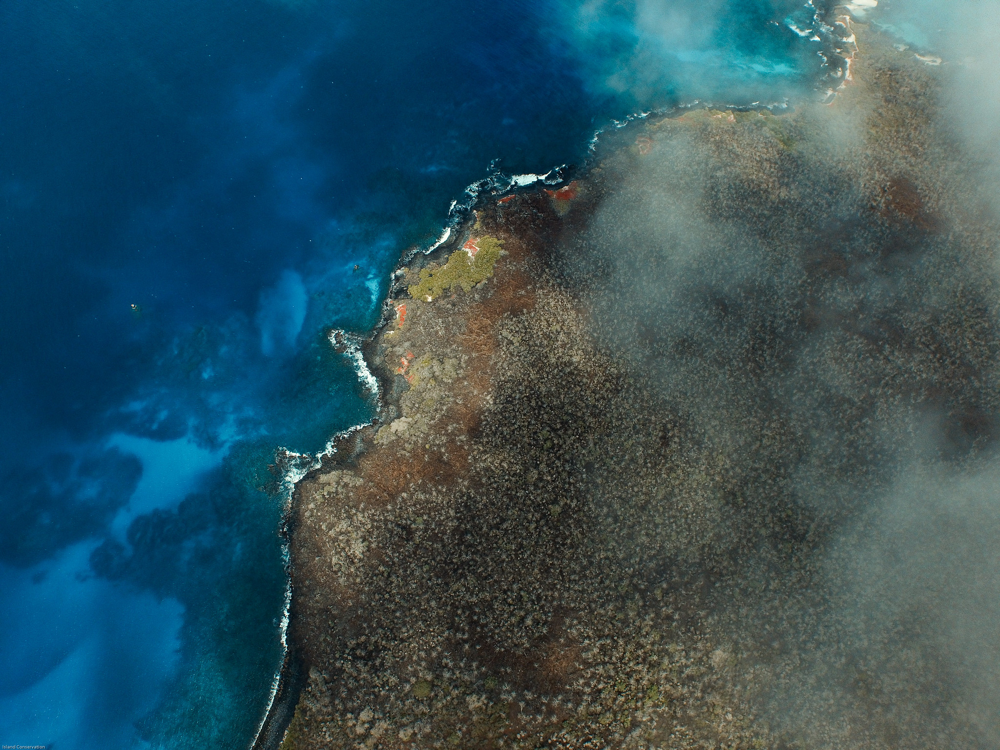

# Preface { - }

Welcome to the [*Island Vital Signs*](https://islandconservation-island-vital-signs.share.connect.posit.cloud/) user manual. This book provides an overview of the *Island Vital Signs* project and tutorials on how to use project data. Land managers, conservation practitioners, spatial analysts, and researchers may all find this book useful for learning about the data and potential applications. You may use the menu on the left side to navigate the book and access different sections.

In Chapter \@ref(introduction), we provide context for the *Island Vital Signs* project, including why remote sensing data is useful for monitoring island ecosystems.

In Chapter \@ref(methods), we provide an overview of the analytical workflow (Section \@ref(analytical-workflow)), background on the Landsat data used within the project (Section \@ref(landsat-and-earth-observation-eo-data)), definitions of the vegetation metrics quantified by *Island Vital Signs* models (Section \@ref(remotely-sensed-vegetation-metrics)), descriptions of the data products produced by *Island Vital Signs* models (Sections \@ref(model-predicted-vegetation-values) and \@ref(model-predicted-vegetation-trends)), and details for all islands that are currently available in the *Island Vital Signs* dataset. For analysts and researchers wishing to learn more about model structure and implementation, we also provide information on data processing (Section \@ref(processing-remote-sensing-data-products)) and time series analysis (Section \@ref(time-series-analysis)).

In Chapter \@ref(application-walkthrough), we provide a tutorial on how to use the online application for *Island Vital Signs*, including how to access data through the application's modules, visualize spatial and temporal trends, and download data to use outside of the application.

Finally, in Chapter \@ref(use-case-studies) we introduce several use case studies that serve as example real-world applications for *Island Vital Signs* data. The chapter opens with an overview of all case studies, and each section that follows describes the analytical workflow for one case study. These workflows are repeatable so that they can be used with data from other islands. In each case study (except Savana), we describe a beginner-friendly workflow for visualizing the data within the *Island Vital Signs* application. For users with technical expertise in QGIS and/or R, we also provide repeatable workflows for analyzing the data within those applications as well.

```{r echo=FALSE, label="floreana-image", out.width='100%', fig.cap='An aerial photo showing the vegetation community on Floreana Island, Galápagos, Ecuador (Photo by Tommy Hall/Island Conservation).'}

```

## Acknowledgments { - }

The *Island Vital Signs* project is funded by Salesforce Nature Accelerator and NASA Biological Diversity and Ecological Conservation award 80NSSC23K1539. The *Island Vital Signs* project team includes members from Island Conservation (Santa Cruz, California), Hobart and William Smith Colleges (Geneva, New York), South Dakota State University (Brookings, South Dakota), State University of New York College of Environmental Science and Forestry (Syracuse, New York), terraPulse Inc. (Gaithersburg, Maryland), and George Washington University (Washington D.C.). The *Island Vital Signs* online application is a product of Island Conservation. All outputs presented in *Island Vital Signs* data are the result of models and analyses developed by team members from Hobart and William Smith Colleges and South Dakota State University, with intellectual support from team members from Island Conservation and State University of New York College of Environmental Science and Forestry, and using remotely sensed data products produced by terraPulse Inc. Thank you to Lara Brenner, Marci Brimhall, Nancy Brunbury, April Burt, Paula A. Castaño, Annabelle Constance, Cielo Figuerola, Katie Franklin, Doug Gillings, Nick Holmes, Paul Jacques, John Knapp, Stefan Kropidlowski, Amy Levine, Annie Little, Sierra Moore, Cozette Romero, Alex Wegmann, Cameron Williams, and Coral Wolf for providing feedback with regards to the framework design and application outputs, and assisting with model validation.

## Project Team { - }

If you have questions about the *Island Vital Signs* project, you may reach out to the following project members:

+ David Will (Island Conservation), Project PI – david.will@islandconservation.org
+ Elke Windschitl (Island Conservation), App Development – elke.windschitl@islandconservation.org
+ Dr. Christy Wails (South Dakota State University), Model Development – christy.wails@sdstate.edu
+ Dr. Bradley Cosentino (Hobart and William Smith College), Model Development – cosentino@hws.edu
+ Dr. Mikayla Call (Hobart and William Smith Colleges), End User Support – call@hws.edu
+ Dr. Joseph Sexton (terraPulse Inc.), Data Production - sexton@terrapulse.com or visit [terrapulse.com](https://terrapulse.com/)
+ Dr. Panshi Wang (terraPulse Inc.), Data Production - wang@terrapulse.com

```{r echo=FALSE, label="contributor-logos", out.width='100%'}

```
